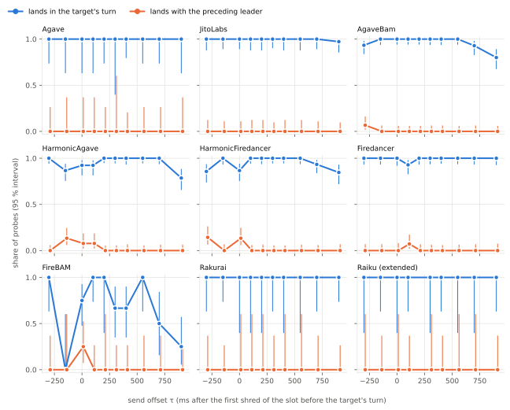

# Inside the Block

What a Solana leader does with two of my transactions that write the same accounts, by client, by when they arrive
around the hand-over, by the gap between them and by block load. Measured on mainnet with my own probes, sent straight
to each leader's TPU port.

**What I found.** Where fee, CU price and reward per cost disagree, the member with the higher reward per cost landed
first, whichever I sent first: Firedancer <!-- v:results.S2.Firedancer.C1.k|int -->19<!-- /v -->/<!-- v:results.S2.Firedancer.C1.n|int -->19<!-- /v --> and <!-- v:results.S2.Firedancer.C2.k|int -->17<!-- /v -->/<!-- v:results.S2.Firedancer.C2.n|int -->17<!-- /v --> pairs, AgaveBam <!-- v:results.S2.AgaveBam.C1.k|int -->21<!-- /v -->/<!-- v:results.S2.AgaveBam.C1.n|int -->21<!-- /v --> and <!-- v:results.S2.AgaveBam.C2.k|int -->20<!-- /v -->/<!-- v:results.S2.AgaveBam.C2.n|int -->20<!-- /v -->,
the two Harmonic clients 90–100 % (Holm p < 0.05 each). Before the turn a higher key overtook a lower one sent
earlier, even on JitoLabs (one validator), whose tie-break favours the earlier arrival
(<!-- v:explore.send_order.split.JitoLabs.S1.pref_sent_second|prop -->0.94 [0.70, 1.00] (15/16)<!-- /v -->). During the turn it overtakes a lower key sent a few milliseconds earlier, never one
sent 50 ms earlier; batches of <!-- v:explore.mechanism.JitoLabs.fit.models.batch.params.B|.0f -->10<!-- /v -->–<!-- v:explore.mechanism.HarmonicAgave.fit.models.batch.params.B|.0f -->55<!-- /v --> ms fit best, a drained queue is not ruled out (exploratory). Of two identical
transactions, Firedancer usually takes the later arrival first (earlier first:
<!-- v:results.P1.Firedancer|prop -->0.19 [0.12, 0.27] (20/107)<!-- /v -->), JitoLabs the earlier one
(<!-- v:results.P1.JitoLabs|prop -->0.73 [0.60, 0.84] (44/60)<!-- /v -->); other clients show no clear tie-break. I
found no evidence that the send time (−300 to +900 ms around the hand-over) changes whether a probe lands in the
target's turn (power about 55–60 %); the effect of block load is inconclusive. Details: [REPORT.md](REPORT.md).

<!-- v:n.identities|int -->14<!-- /v --> validators, <!-- v:n.families|int -->9<!-- /v --> clients as named in gossip, <!-- v:n.probes|int -->3,180<!-- /v --> probes in <!-- v:n.quads_fired|int -->795<!-- /v --> quads,
mainnet <!-- v:n.first_day -->2026-10-30<!-- /v --> to <!-- v:n.last_day -->2026-11-03<!-- /v --> (UTC), fees <!-- v:n.fees_sol|.4f -->0.0165<!-- /v --> SOL.

## The turn

<picture>
  <source media="(prefers-color-scheme: dark)" srcset="figures/turn-map-dark.svg">
  
</picture>

Probes landing in the target's turn (blue) or with the leader before it (orange) by send time, 95 % intervals
([REPORT §4](REPORT.md#4-position-in-the-leaders-turn)).

## Validators measured

<!-- table:validators -->
*Source: gossip views in data/raw/*/quads.jsonl; results/results.json → descriptive.per_target. Descriptive; verdicts are per client family (REPORT §3); under 15 pairs is too few to read. `shared`: another staked node advertises the same TPU host.*

| target | validator | client (gossip) | versions seen | ingress | F: sent first, landed first (equal keys) | R: higher key landed first (HI/LO pairs) | probes in its turn |
|---|---|---|---|---|---|---|---|
| T1 | [mds4…cT6Z](https://explorer.solana.com/address/mds4GEuiSgQRqveGyktWpETBFCb4AS2wDnhqwLHcT6Z) | Agave | 4.4.0, 4.4.0-rc.1 | direct | 0.74 [0.49, 0.91] (14/19) | 0.38 [0.14, 0.68] (5/13) | 1.00 [0.96, 1.00] (100/100) |
| T2 | [9rkJ…NDSQ](https://explorer.solana.com/address/9rkJMARqK6VBkcxGfKBAwnA44gPAfGxPbPsfsggFNDSQ) | AgaveBam | 4.3.2, 4.4.0 | shared | 0.33 [0.01, 0.91] (1/3) | 0.33 [0.01, 0.91] (1/3) | 1.00 [0.99, 1.00] (296/296) |
| T3 | [3SkE…NzXd](https://explorer.solana.com/address/3SkE34PVeGck2ArEffFKjihrQgURsvnoTAhitsNXNzXd) | JitoLabs | 4.3.2 | direct | 0.75 [0.62, 0.86] (43/57) | 0.64 [0.45, 0.80] (21/33) | 1.00 [0.98, 1.00] (291/292) |
| T4 | [5Cch…q9Ux](https://explorer.solana.com/address/5Cchr1XGEg7dbBXByV5NY2ad8jfxAM7HA3x8D56rq9Ux) | AgaveBam | 4.3.2, 4.4.0 | direct_other_host | 0.47 [0.34, 0.61] (28/59) | 0.59 [0.42, 0.75] (22/37) | 0.99 [0.97, 1.00] (288/292) |
| T5 | [GzDf…4ZzG](https://explorer.solana.com/address/GzDfKKoZ6E8ReqKfH96k5bkmA6CEWtnUrQnZjSqW4ZzG) | AgaveBam | 4.3.2, 4.4.0 | shared | 0.46 [0.33, 0.59] (27/59) | 0.62 [0.44, 0.78] (21/34) | 0.95 [0.91, 0.97] (276/292) |
| T6 | [FBKF…jeNi](https://explorer.solana.com/address/FBKFWadXZJahGtFitAsBvbqh5968gLY7dMBBJUoUjeNi) | HarmonicAgave | 4.3.2, 4.4.0 | shared | 0.56 [0.42, 0.69] (33/59) | 0.71 [0.52, 0.86] (22/31) | 0.97 [0.94, 0.98] (294/304) |
| T7 | [5Zqv…q9qk](https://explorer.solana.com/address/5ZqveVffQPiUbkjBg4KD9kib1MKHLqiFno4ke9jSq9qk) | HarmonicAgave | 4.3.2 | shared | 0.55 [0.41, 0.69] (31/56) | 0.59 [0.39, 0.78] (16/27) | 0.94 [0.90, 0.96] (262/280) |
| T8 | [Awes…vpLM](https://explorer.solana.com/address/Awes4Tr6TX8JDzEhCZY2QVNimT6iD1zWHzf1vNyGvpLM) | HarmonicFiredancer | 26.10.5 | shared | 0.51 [0.36, 0.66] (25/49) | 0.67 [0.48, 0.82] (22/33) | 0.92 [0.88, 0.95] (261/284) |
| T9 | [6ptu…JwWG](https://explorer.solana.com/address/6ptuwW4rg5A3wP9hNKxeymG3QhSagugPd3grnMTGJwWG) | HarmonicFiredancer | 26.10.5 | shared | 0.55 [0.42, 0.68] (33/60) | 0.74 [0.57, 0.87] (28/38) | 0.98 [0.96, 0.99] (291/296) |
| T10 | [9eGr…8FoY](https://explorer.solana.com/address/9eGrDohdNTAo61DRHyfMuqKWXqYnA3i254Wiszxe8FoY) | Firedancer | 26.10.5 | direct | 0.25 [0.14, 0.38] (14/57) | 0.74 [0.57, 0.88] (26/35) | 0.99 [0.96, 1.00] (284/288) |
| T11 | [BFmq…Wmzy](https://explorer.solana.com/address/BFmqBsaGjeYA7gHpReKmnVkRyhqiMmHoR9ttv1crWmzy) | Firedancer | 26.10.5 | direct | 0.12 [0.05, 0.24] (6/50) | 0.67 [0.47, 0.83] (20/30) | 1.00 [0.98, 1.00] (240/240) |
| T12 | [qZMH…QrbP](https://explorer.solana.com/address/qZMH9GWnnBkx7aM1h98iKSv2Lz5N78nwNSocAxDQrbP) | FireBAM | 26.10.5 | shared | 0.78 [0.40, 0.97] (7/9) | 0.86 [0.42, 1.00] (6/7) | 0.70 [0.60, 0.79] (67/96) |
| T13 | [Ed9W…a2Zv](https://explorer.solana.com/address/Ed9WjPnZfAXsPttcqxMwj94qsuXVRyBsyXnDkxFva2Zv) | Rakurai | 4.4.0 | direct | 0.50 [0.21, 0.79] (6/12) | 0.43 [0.10, 0.82] (3/7) | 1.00 [0.95, 1.00] (68/68) |
| X1 | [9xcX…eczT](https://explorer.solana.com/address/9xcXe4WRAfbVoVgQmFD5xgFHioL9dD7c74pQZ7PeczT) | Raiku | 4.4.0 | direct | 0.70 [0.35, 0.93] (7/10) | 0.71 [0.29, 0.96] (5/7) | 1.00 [0.93, 1.00] (52/52) |
<!-- /table:validators -->

Tests and thresholds were fixed in [PREREGISTRATION.md](docs/PREREGISTRATION.md), hashed on chain before the first
campaign probe. Verdicts per family: [REPORT §3](REPORT.md#3-verdicts).

## How it works

**What did you send?** Per leader turn, four probes: a main pair whose members differ in fee or cost, and a control
pair of identical keys. Each probe pays 1 lamport to the other member's payer, so the leader must put one first.

**Why the identical pair?** Same leader, moment and path, nothing to sort by: its order is the tie-break, the
baseline for every other pair.

**Why pairs whose keys disagree?** Reward per cost (the key Agave's scheduler computes), CU price and total fee prefer
different members, so the member that lands first names the key.

**Why random send times and gaps?** Before the turn a transaction waits; during it, the scheduler is already
building blocks. The send offset (−300 to +900 ms from the first shred of the slot before the turn) and the gap between
the members (0–100 ms) were drawn at random per quad.

**Why two validators per client?** To tell the client from one operator's setup ([REPORT §7](REPORT.md#7-clients-and-operators)).

**What can't this tell apart?** The validator from a block engine in front of it, send from arrival time below
network jitter, a client from its operators' settings: [REPORT §10](REPORT.md#10-what-this-study-does-not-separate).

**The six points of the brief** (details and what each leaves open: [DESIGN.md](docs/DESIGN.md#the-six-things-the-brief-asks-to-account-for)):

| point | how the design handles it |
|---|---|
| leader schedule and leader types | turns from `getLeaderSchedule`; each block's leader re-read from its fee reward; client from gossip every 60 s |
| path to the executing node | my own unstaked QUIC client straight to the leader's TPU, no RPC, no retries; landings with the previous leader counted (S3) |
| my own transactions | each pair writes only its own two payers; the two pairs of a quad share nothing |
| competition inside the block | only the relative order of my two members is read; every probed block archived; load is a tested moderator (P3) |
| send order | random in EQ and C pairs; in R pairs the cheaper member goes first by a random gap (a race) |
| noise vs rule | an equal-key control in every quad, pre-registered Holm-corrected tests, "insufficient data" under 15 pairs, a power study |

## Re-run it

```
git clone https://github.com/btccdbcb/inside-the-block && cd inside-the-block
docker compose up                       # offline: recomputes every result, table and figure, prints "0 differences"
docker compose --profile verify up      # online: re-checks 60 random claims, the Memo and ledger = chain on public RPC
```

Raw data: `data/raw/` ([DATA.md](docs/DATA.md)); the verifier: [VERIFY.md](docs/VERIFY.md). Or check a block by
hand:

<!-- table:examples -->
*Source: results/pairs.csv and results/probes.csv (the first campaign example of each kind, by run and quad, chosen by how it was sent).*

Where the two equal-key probes of quad C-T1-001 sit in the block of slot 463,481,852 (curl and jq; after a 429 from the public endpoint, wait a few seconds and retry):

```
curl -s https://api.mainnet-beta.solana.com -H 'Content-Type: application/json' -d '{"jsonrpc":"2.0","id":1,
  "method":"getBlock","params":[463481852,{"transactionDetails":"signatures",
  "maxSupportedTransactionVersion":0,"rewards":false}]}' \
  | jq '.result.signatures | index("28MtzrFQmAEi7HNGnzPfF52RBxUfbdLiTXeBR2bJEjpdELnCFZJWe5V6i4agNDAgZ6VQtrjRr9LPNAD9XrEVBK4a"),
                             index("5r7d2mYcjWWFm44W15cennWbjRivQkEvBXKyRUG71Cmtmpauwj8cpiiY1PJ6AQWUrUxTVDLMtu9GsWow3PYriP7v")'
```

It prints 89 and 114: the probe sent first is earlier in the block.

| example | quad | slot | probes, in sending order | position in block |
|---|---|---|---|---|
| equal keys (A = A) | C-T1-001 | 463,481,852 | [A sent first](https://explorer.solana.com/tx/28MtzrFQmAEi7HNGnzPfF52RBxUfbdLiTXeBR2bJEjpdELnCFZJWe5V6i4agNDAgZ6VQtrjRr9LPNAD9XrEVBK4a), [A sent second](https://explorer.solana.com/tx/5r7d2mYcjWWFm44W15cennWbjRivQkEvBXKyRUG71Cmtmpauwj8cpiiY1PJ6AQWUrUxTVDLMtu9GsWow3PYriP7v) | 89, 114 |
| sent before the turn to JitoLabs, HI = higher fee and priority, sent second | C-T3-002 | 463,481,224 | [LO sent first](https://explorer.solana.com/tx/2xM3Rij7wemsn81NBuqjETKArs1NCGYECJWM92KFQuefFvpdfM2LEWJBCXcY4nS5MWqH8hGxVt9S4JozXiW4gQcw), [HI sent second](https://explorer.solana.com/tx/2BPuycGmNnUyff2RY5cVj8TaQ2PAbi2p7RJfF1zApLPi1R2ttbNdNrhuYXwqMfqB4sFWz32Uf2vruR91KVDe9WJA) | 27, 26 |
| keys disagree: Q = higher reward per cost, sent second; P = higher CU price | C-T11-008 | 463,505,610 | [P sent first](https://explorer.solana.com/tx/3hWBJ9PzXhBni3C7pJ9NkUcDCNNMkJjMQrbK9wzPruv1zWhkRg987ugq6isHZEWcumeftjPHXqKFhzeTsjwtFVo5), [Q sent second](https://explorer.solana.com/tx/ps8tuMck6Z24gM98fWEePTAGaTrg5inELc2j37WXfYsyz8tK7go5CAXq3JUDqEqTUJgPuqtoMNTwrcyL4b1zN8R) | 496, 479 |
| landed with the leader before the target | C-T5-011 | 463,520,234 | [A](https://explorer.solana.com/tx/5eeefPTiwaqsQwHrk1nF6v1MMW6RQBgzsoQd7ywPPkXLBtWatZftAV1QmAQimciPt6AXXyRKXsYMB8CUfq71ZLxa) | 11 |
<!-- /table:examples -->

## Money and keys

<!-- table:money -->
*Source: data/live/ledger.csv, data/live/ledger_check.json.*

|  |  |
|---|---|
| fees paid | 16,458,860 lamports (0.016459 SOL) of the 30,000,000 cap |
| ledger = chain | yes, to the lamport |
| sweep | 9 transactions; the last [5m1eAs…2gp3](https://explorer.solana.com/tx/5m1eAsSHk2EW6wMowwypKPSPSyAypYrwjJbNkrEgPF32KZEDV5JAw7Enu9ZvSDoakpGriuKzN6gYFTodvPXZ2gp3) |
<!-- /table:money -->

The 0.03 SOL fee cap is compiled into the sender; every probe's worst-case fee is reserved in a ledger before sending.
Nothing is sent without `itb live --live`. Keys stay outside the repository; a pre-commit check, CI and gitleaks refuse
committed keys. The spend check stopped the programme once, on a wrong block height from a public RPC; nothing was
lost ([REPORT §8](REPORT.md#8-what-went-wrong)). Running it live yourself: [DESIGN.md](docs/DESIGN.md#money-and-keys).

## Files

```
crates/itb/          the sender (Rust): timing, QUIC, probes, ledger, live programme
analysis/            collection, outcomes, the pre-registered tests, verification, figures, report tables (Python)
design/, data/       the frozen targets, design rows and campaign; raw runs, dry runs and the live ledger
results/, figures/   everything derived, regenerated by `docker compose up`
docs/, REPORT.md     PREREGISTRATION, DESIGN, DATA, POWER, VERIFY; the full results, what went wrong, cost
```

Apache License 2.0 ([LICENSE](LICENSE)). Submitted version: tag
[`submission-2026-11-05`](https://github.com/btccdbcb/inside-the-block/tree/submission-2026-11-05).
