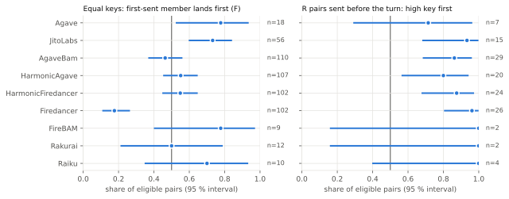
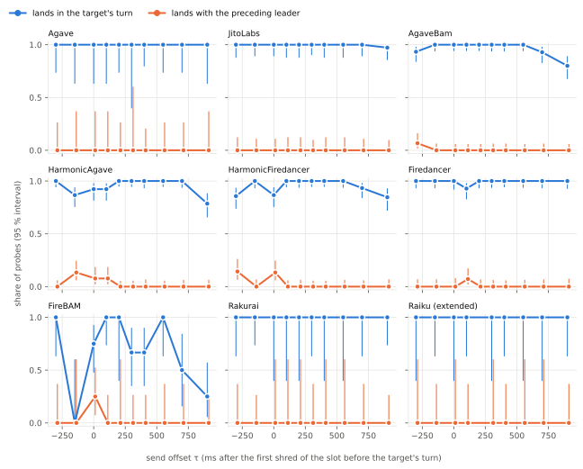
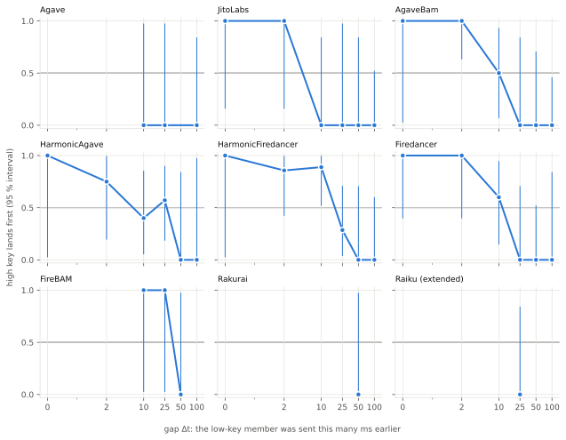

# Report

What I measured, how, what came out, and what went wrong. The rules were frozen before the campaign
([PREREGISTRATION.md](docs/PREREGISTRATION.md)); the design reasoning is in [DESIGN.md](docs/DESIGN.md); the data
layout is in [DATA.md](docs/DATA.md). Every table below is generated from the committed data by `docker compose up`
(`analysis/itb_analysis/report.py`), which also checks that the tables here still match the data. Each table names the
file it comes from.

Confirmatory results (pre-registered tests, Holm-adjusted) are in §2–§5 and are labelled as such. Everything else is
exploratory or descriptive and says so.

## 0. Summary

<!-- v:n.quads_fired|int -->795<!-- /v --> quads (<!-- v:n.probes|int -->3,180<!-- /v --> probes) sent to
<!-- v:n.identities|int -->14<!-- /v --> mainnet validators whose gossip named
<!-- v:n.families|int -->9<!-- /v --> different clients, in the smoke, pilot and four campaign runs (§1). Estimates are
shares with 95 % intervals and k/n; confirmatory tests give their id and Holm-adjusted p.

1. **Equal keys: Firedancer puts the later arrival first, JitoLabs the earlier one (P1).** For two identical
   transactions, the one sent first landed first in F = <!-- v:results.P1.Firedancer|prop -->0.19 [0.12, 0.27] (20/107)<!-- /v -->
   of Firedancer pairs (Holm p <!-- v:results.holm_primary.P1:Firedancer|p -->< 0.001<!-- /v -->) and in
   F = <!-- v:results.P1.JitoLabs|prop -->0.73 [0.60, 0.84] (44/60)<!-- /v --> of JitoLabs pairs (Holm p
   <!-- v:results.holm_primary.P1:JitoLabs|p -->0.006<!-- /v -->). AgaveBam
   (<!-- v:results.P1.AgaveBam|prop -->0.47 [0.37, 0.56] (55/118)<!-- /v -->), HarmonicAgave
   (<!-- v:results.P1.HarmonicAgave|prop -->0.56 [0.46, 0.65] (64/115)<!-- /v -->) and HarmonicFiredancer
   (<!-- v:results.P1.HarmonicFiredancer|prop -->0.53 [0.43, 0.63] (58/109)<!-- /v -->) are not distinguishable from
   0.5.
2. **The key is reward per cost, not CU price and not total fee (S2).** Where the candidate keys disagree, the member
   with the higher reward per cost went first: Firedancer
   <!-- v:results.S2.Firedancer.C1|prop -->1.00 [0.82, 1.00] (19/19)<!-- /v --> against the higher total fee (C1) and
   <!-- v:results.S2.Firedancer.C2|prop -->1.00 [0.80, 1.00] (17/17)<!-- /v --> against the higher CU price (C2), and
   the same for AgaveBam, HarmonicAgave and HarmonicFiredancer (§3, all Holm p < 0.05). In these pairs the send order
   is randomised, and the result holds whichever member I sent first (§3, send order).
3. **Before the turn, a higher key overtakes a lower one sent earlier (S1).** In pairs sent before the target's turn,
   the higher-key member landed first in <!-- v:results.S1.Firedancer|prop -->0.96 [0.82, 1.00] (27/28)<!-- /v --> of
   Firedancer pairs, <!-- v:results.S1.AgaveBam|prop -->0.87 [0.69, 0.96] (26/30)<!-- /v --> AgaveBam,
   <!-- v:results.S1.HarmonicFiredancer|prop -->0.88 [0.70, 0.98] (23/26)<!-- /v --> HarmonicFiredancer and
   <!-- v:results.S1.JitoLabs|prop -->0.94 [0.70, 1.00] (15/16)<!-- /v --> JitoLabs (each Holm p < 0.05; HarmonicAgave
   <!-- v:results.S1.HarmonicAgave|prop -->0.82 [0.60, 0.95] (18/22)<!-- /v -->, Holm p
   <!-- v:results.holm_secondary.S1:HarmonicAgave|p -->0.052<!-- /v -->). These are race pairs: the higher key was sent
   second in 121 of the 137 (§9). On JitoLabs, whose tie-break favours the earlier arrival (item 1), that still shows a
   key at work. On Firedancer, whose tie-break takes the later arrival first, S1 alone cannot tell the key from the
   tie-break; there the key claim rests on S2.
4. **Inside the turn, only a small head start is overtaken (descriptive, §6).** A higher key sent 2 ms after a lower
   one still landed first in <!-- v:results.RRR.Firedancer.2|prop -->1.00 [0.48, 1.00] (5/5)<!-- /v --> of Firedancer
   pairs and <!-- v:results.RRR.AgaveBam.2|prop -->1.00 [0.66, 1.00] (9/9)<!-- /v --> of AgaveBam pairs; with a head
   start of 50 ms or more it never did, in any family. Of four models fitted to these rates, batches fit best in all
   five families with 16 or more pairs (Akaike weight 0.36–0.77; a continuously drained queue gets 0.23–0.30 and is not
   ruled out), with fitted lengths, resolved only to the tested gaps of 0–100 ms, from
   <!-- v:explore.mechanism.JitoLabs.fit.models.batch.params.B|.0f -->10<!-- /v --> ms (JitoLabs) to
   <!-- v:explore.mechanism.HarmonicAgave.fit.models.batch.params.B|.0f -->55<!-- /v --> ms (HarmonicAgave)
   (exploratory, §6).
5. **When I sent did not change where the probes landed (P2, S3).**
   <!-- v:n.in_turn|int -->3,070<!-- /v --> of <!-- v:n.probes|int -->3,180<!-- /v --> probes landed in the target's
   turn. No family shows evidence that landing in the turn, or leaking to the leader before it, depends on the send
   offset between −300 and +900 ms (smallest Holm p <!-- v:n.p2_min_holm|p -->0.466<!-- /v --> for P2 and
   <!-- v:n.s3_min_holm|p -->0.998<!-- /v --> for S3). This is an absence of evidence, not a shown absence: P2's power
   per family was about 55–60 % under the effect the design assumed ([POWER.md](docs/POWER.md)), and in-turn landing is
   close to its ceiling.
6. **Block load: inconclusive (P3).** The slope of P(higher key first) on block load is
   <!-- v:results.P3.pooled.beta|.2f -->0.06<!-- /v --> logit per 10M CU, 90 % interval
   [<!-- v:results.P3.pooled.ci90.0|.2f -->-0.30<!-- /v -->, <!-- v:results.P3.pooled.ci90.1|.2f -->0.42<!-- /v -->],
   not inside the pre-registered ±0.4 margin and not different from 0.
7. **Validators of one client differ (exploratory, §7).** One JitoLabs target ran AgaveBam for most of the campaign
   (§1), so the JitoLabs results rest on one validator, T3, as the Agave ones rest on T1; the two HarmonicFiredancer
   validators differ in how often my probes landed in their turn
   (<!-- v:explore.operators.HarmonicFiredancer.targets.T8.in_turn|prop -->0.92 [0.88, 0.95] (261/284)<!-- /v --> and
   <!-- v:explore.operators.HarmonicFiredancer.targets.T9.in_turn|prop -->0.98 [0.96, 0.99] (291/296)<!-- /v -->,
   χ² p <!-- v:explore.operators.HarmonicFiredancer.in_turn_homogeneity.p_value|p -->< 0.001<!-- /v -->), as do the
   two AgaveBam ones (p <!-- v:explore.operators.AgaveBam.in_turn_homogeneity.p_value|p -->0.012<!-- /v -->).

## 1. Measurement log

Every run of the sender, dry or live. Times are UTC; slots are mainnet slots. A dry run builds, signs and times every
probe but sends nothing.

<!-- table:runs -->
*Source: data/raw/*/ and data/dry_runs/*/ (quads.jsonl, run.json, outcomes.jsonl); sender commit of live runs: the service start logged in data/live/live.log.*

| run | kind | UTC, first → last quad | slot0 range | targets | quads fired / attempted | probes | landed | fees (lamports) | sender commit |
|---|---|---|---|---|---|---|---|---|---|
| 20261029T113453109-dry | dry run | 2026-10-29 11:36 → 16:31 | 462866396–462949080 | 12 | 153/194 | — | — | — | b7121c4 |
| 20261029T163724083-dry | dry run | 2026-10-29 16:41 → 10-30 05:14 | 462951944–463163148 | 14 | 486/494 | — | — | — | 531f504+uncommitted runner fixes (recheck/reconnect, pre-open) |
| 20261030T154848184-smoke | live | 2026-10-30 15:49 → 16:11 | 463341556–463347876 | 2 | 4/4 | 16 | 16 | 82,384 | e3be1fe |
| 20261030T161201581-pilot | live | 2026-10-30 16:12 → 19:11 | 463348264–463398292 | 14 | 39/39 | 156 | 156 | 950,676 | e3be1fe |
| 20261031T000007392-session-C | live | 2026-10-31 00:01 → 04:59 | 463479204–463562584 | 14 | 215/218 | 860 | 847 | 4,379,666 | e3be1fe |
| 20261031T100006476-session-A | live | 2026-10-31 10:00 → 13:58 | 463647152–463713744 | 14 | 242/245 | 968 | 951 | 4,917,284 | e3be1fe |
| 20261102T140019428-session-B | live | 2026-11-02 14:04 → 17:58 | 464522272–464587748 | 14 | 248/250 | 992 | 988 | 5,113,142 | e3be1fe |
| 20261103T140013075-session-D | live | 2026-11-03 14:01 → 14:59 | 464924920–464941040 | 13 | 47/50 | 188 | 184 | 950,708 | e3be1fe |
<!-- /table:runs -->

The pre-registration Memo, checked against the committed files and the first campaign probe:

<!-- table:memo -->
*Source: data/live/memo_check.json (`itb-analysis memo-check`, public mainnet RPC).*

|  |  |
|---|---|
| Memo transaction | [39KUjB…zFNd](https://explorer.solana.com/tx/39KUjBQrwzX81CsBmLBmK8vstWpci2zYG5E6yxBrRJFLQZpPB16zMTjmYk2mApsY9nB5xYkTKhLZzGYiYkGjzFNd), slot 463,398,906, 2026-10-30 19:14:03 UTC |
| sha256 of PREREGISTRATION.md | `2bb1b26d53527aed…` = the Memo |
| sha256 of campaign.json | `65d63ef0cf5aafb9…` = the Memo |
| sha256 of design.jsonl | `91f27c8a650ab841…` = the Memo |
| sha256 of pilot_decision | `b3ab5c025404d4b5…` = the Memo |
| first campaign send | 2026-10-31 00:01:01 UTC (quad C-T6-001) |
| first campaign turn | slot 463,479,204 |
| confirmatory code changed since the freeze | none |
| result | PASS |
<!-- /table:memo -->

The first probed turn began at slot <!-- v:n.first_slot|int -->463,341,556<!-- /v -->, after slot 459,653,008 where
the brief's measurement window begins (the sender refuses earlier slots, and so does the analysis).

Gossip views that changed during the runs, or that named a client other than the target's design family. A quad whose
leader's gossip client is not its family, before or after the quad, is left out of the family tests (PREREGISTRATION §3,
eligibility rule 3) and put back in sensitivity analysis (b):

<!-- table:clients -->
*Source: gossip views in data/raw/*/quads.jsonl; design family from results/results.json → descriptive.per_target.*

| target | design family | client (gossip) | version | quads | UTC, first → last quad |
|---|---|---|---|---|---|
| T1 | Agave | Agave | 4.4.0-rc.1 | 14 | 2026-10-30 16:14 → 10-31 12:53 |
| T1 | Agave | Agave | 4.4.0 | 11 | 2026-10-31 13:25 → 11-03 14:28 |
| T2 | JitoLabs | JitoLabs | 4.3.2 | 4 | 2026-10-30 15:55 → 10-30 16:51 |
| T2 | JitoLabs | AgaveBam | 4.4.0 | 70 | 2026-10-30 18:41 → 11-03 14:40 |
| T4 | AgaveBam | AgaveBam | 4.3.2 | 68 | 2026-10-30 17:01 → 11-02 17:50 |
| T4 | AgaveBam | AgaveBam | 4.4.0 | 5 | 2026-11-03 14:07 → 11-03 14:58 |
| T5 | AgaveBam | AgaveBam | 4.3.2 | 52 | 2026-10-30 17:00 → 11-02 15:11 |
| T5 | AgaveBam | AgaveBam | 4.4.0 | 21 | 2026-11-02 15:22 → 11-03 14:59 |
| T6 | HarmonicAgave | HarmonicAgave | 4.3.2 | 5 | 2026-10-30 15:49 → 10-30 18:36 |
| T6 | HarmonicAgave | HarmonicAgave | 4.4.0 | 71 | 2026-10-31 00:01 → 11-03 14:57 |
<!-- /table:clients -->

## 2. Gates

The gates check the method before any claim is read (PREREGISTRATION §5, "Gates").

**G2, timing.** (a) share of quads whose first send left within 50 ms of plan; (b) for quads planned before the turn,
share whose send preceded the first shred of the turn's first slot. The predicted-anchor error is how far the predicted
first shred of the slot before the turn was from the observed one, for the τ levels that fire before that event.

<!-- table:timing -->
*Source: results/timing.json (timing.py).*

| runs | quads fired | (a) sent within 50 ms of plan | G2a | (b) pre-turn sends before slot 0 | G2b | predicted anchor, absolute error p50 / p90 (ms) |
|---|---|---|---|---|---|---|
| campaign | 795 | 0.994 (795) | pass | 1.000 (392) | pass | 2.0 / 38.0 |
| dry run | 639 | 1.000 (639) | pass | 1.000 (330) | pass | 2.0 / 17.0 |
<!-- /table:timing -->

**G1, positive controls, and G3, selection.**

<!-- table:gates -->
*Source: results/results.json → G1, G3; G4: results/pairs.csv → exclusion.*

| gate |  |  | result |
|---|---|---|---|
| G1 Agave line | C1 0.76 [0.50, 0.93] (13/17) | C2 0.92 [0.64, 1.00] (12/13) | pass |
| G1 Firedancer | C1 1.00 [0.82, 1.00] (19/19) | C2 1.00 [0.80, 1.00] (17/17) | pass |
| G3 C1 | preferred only in turn: 0 | other only: 0 | McNemar p 1.000 |
| G3 C2 | preferred only in turn: 0 | other only: 0 | McNemar p 1.000 |
| G3 C3 | preferred only in turn: 0 | other only: 0 | McNemar p 1.000 |
| G3 EQ | preferred only in turn: 2 | other only: 0 | McNemar p 0.500 |
| G3 R | preferred only in turn: 0 | other only: 4 | McNemar p 0.125 |
| G3 R_IND | preferred only in turn: 0 | other only: 3 | McNemar p 0.250 |
| G3 V_EQ | preferred only in turn: 1 | other only: 0 | McNemar p 1.000 |
| G3 V_HI | preferred only in turn: 0 | other only: 0 | McNemar p 1.000 |
| G4 attribution | pairs with a member outside the target's turn: 60 | of 1590 pairs | excluded by eligibility |
<!-- /table:gates -->

No gate failed, so no claim is downgraded to exploratory. G4 is enforced by eligibility: a pair counts only when both
members landed in a block whose fee-reward recipient is the target, and the table gives how many pairs that removed.
The Agave-line control passes with less to spare than Firedancer's: its C1 interval reaches down to 0.50, from 17 pairs
pooled over the Agave and JitoLabs families, as pre-registered (AgaveBam and the Harmonic families are not in it). It recovers
the key the Agave scheduler code names, but as a positive control it is weaker than the 100 % that AgaveBam and
Firedancer show in S2 (§3).

## 3. Verdicts

The verdict words are applied mechanically to the Holm-adjusted p-values (PREREGISTRATION §5); "insufficient data"
below 15 eligible pairs (15 quads for P2 and S3).

<!-- table:verdicts -->
*Source: results/results.json → verdicts (PREREGISTRATION §5 wording).*

| family | P1 | P2 | S1 | S2-C1 | S2-C2 | S2-C3 | S3 |
|---|---|---|---|---|---|---|---|
| Agave | F not distinguishable from 0.5 | no evidence that landing depends on the send offset | insufficient data | insufficient data | insufficient data | insufficient data | no evidence that leakage depends on the send offset |
| JitoLabs | arrival order breaks ties (F > 0.5) | no evidence that landing depends on the send offset | higher key first in the backlog (P(HI first) > 0.5) | insufficient data | insufficient data | insufficient data | no evidence that leakage depends on the send offset |
| AgaveBam | F not distinguishable from 0.5 | no evidence that landing depends on the send offset | higher key first in the backlog (P(HI first) > 0.5) | reward/cost-preferred member first | reward/cost-preferred member first | reward/cost-preferred member first | no evidence that leakage depends on the send offset |
| HarmonicAgave | F not distinguishable from 0.5 | no evidence that landing depends on the send offset | no key preference shown in the backlog | reward/cost-preferred member first | reward/cost-preferred member first | reward/cost-preferred member first | no evidence that leakage depends on the send offset |
| HarmonicFiredancer | F not distinguishable from 0.5 | no evidence that landing depends on the send offset | higher key first in the backlog (P(HI first) > 0.5) | reward/cost-preferred member first | reward/cost-preferred member first | insufficient data | no evidence that leakage depends on the send offset |
| Firedancer | latest arrival first (F < 0.5) | no evidence that landing depends on the send offset | higher key first in the backlog (P(HI first) > 0.5) | reward/cost-preferred member first | reward/cost-preferred member first | reward/cost-preferred member first | no evidence that leakage depends on the send offset |
| FireBAM | insufficient data | no evidence that landing depends on the send offset | insufficient data | insufficient data | insufficient data | insufficient data | no evidence that leakage depends on the send offset |
| Rakurai | insufficient data | no evidence that landing depends on the send offset | insufficient data | insufficient data | insufficient data | insufficient data | no evidence that leakage depends on the send offset |
<!-- /table:verdicts -->

### Primary tests

<!-- table:primary -->
*Source: results/results.json → P1, P2, P3, holm_primary.*

| family | P1: F (first-sent first), 95 % CI | P1 p | P1 Holm p | P2 quads | P2 p | P2 Holm p |
|---|---|---|---|---|---|---|
| Agave | 0.74 [0.49, 0.91] (14/19) | 0.064 | 0.826 | 25 | 1.000 | 1.000 |
| JitoLabs | 0.73 [0.60, 0.84] (44/60) | < 0.001 | 0.006 | 77 | 1.000 | 1.000 |
| AgaveBam | 0.47 [0.37, 0.56] (55/118) | 0.519 | 1.000 | 146 | 0.056 | 0.780 |
| HarmonicAgave | 0.56 [0.46, 0.65] (64/115) | 0.263 | 1.000 | 146 | 0.031 | 0.466 |
| HarmonicFiredancer | 0.53 [0.43, 0.63] (58/109) | 0.566 | 1.000 | 145 | 0.086 | 1.000 |
| Firedancer | 0.19 [0.12, 0.27] (20/107) | < 0.001 | < 0.001 | 132 | 0.873 | 1.000 |
| FireBAM | 0.78 [0.40, 0.97] (7/9) | 0.180 | 1.000 | 24 | 0.464 | 1.000 |
| Rakurai | 0.50 [0.21, 0.79] (6/12) | 1.000 | 1.000 | 17 | 1.000 | 1.000 |
<!-- /table:primary -->

### Secondary tests

<!-- table:secondary -->
*Source: results/results.json → S1, S2, P2 (leak), holm_secondary.*

| family | S1: P(HI first) pre-turn | S1 Holm p | S2 C1 | S2 C2 | S2 C3 | S3 Holm p |
|---|---|---|---|---|---|---|
| Agave | 0.71 [0.29, 0.96] (5/7) | 1.000 | 0.75 [0.19, 0.99] (3/4); Holm p 1.000 | 1.00 [0.16, 1.00] (2/2); Holm p 1.000 | 1.00 [0.29, 1.00] (3/3); Holm p 1.000 | 1.000 |
| JitoLabs | 0.94 [0.70, 1.00] (15/16) | 0.006 | 0.77 [0.46, 0.95] (10/13); Holm p 0.969 | 0.91 [0.59, 1.00] (10/11); Holm p 0.135 | 1.00 [0.59, 1.00] (7/7); Holm p 0.172 | 1.000 |
| AgaveBam | 0.87 [0.69, 0.96] (26/30) | < 0.001 | 1.00 [0.84, 1.00] (21/21); Holm p < 0.001 | 1.00 [0.83, 1.00] (20/20); Holm p < 0.001 | 1.00 [0.79, 1.00] (16/16); Holm p < 0.001 | 1.000 |
| HarmonicAgave | 0.82 [0.60, 0.95] (18/22) | 0.052 | 1.00 [0.83, 1.00] (20/20); Holm p < 0.001 | 0.96 [0.79, 1.00] (23/24); Holm p < 0.001 | 1.00 [0.79, 1.00] (16/16); Holm p < 0.001 | 1.000 |
| HarmonicFiredancer | 0.88 [0.70, 0.98] (23/26) | 0.001 | 0.95 [0.74, 1.00] (18/19); Holm p 0.001 | 0.90 [0.68, 0.99] (18/20); Holm p 0.005 | 1.00 [0.77, 1.00] (14/14); Holm p 0.002 | 0.998 |
| Firedancer | 0.96 [0.82, 1.00] (27/28) | < 0.001 | 1.00 [0.82, 1.00] (19/19); Holm p < 0.001 | 1.00 [0.80, 1.00] (17/17); Holm p < 0.001 | 1.00 [0.79, 1.00] (16/16); Holm p < 0.001 | 1.000 |
| FireBAM | 1.00 [0.16, 1.00] (2/2) | 1.000 | 1.00 [0.16, 1.00] (2/2); Holm p 1.000 | 1.00 [0.16, 1.00] (2/2); Holm p 1.000 | 1.00 [0.16, 1.00] (2/2); Holm p 1.000 | 1.000 |
| Rakurai | 1.00 [0.16, 1.00] (2/2) | 1.000 | 1.00 [0.29, 1.00] (3/3); Holm p 1.000 | 1.00 [0.40, 1.00] (4/4); Holm p 1.000 | 1.00 [0.03, 1.00] (1/1); Holm p 1.000 | 1.000 |
<!-- /table:secondary -->

<picture>
  <source media="(prefers-color-scheme: dark)" srcset="figures/order-dark.svg">
  
</picture>

F on equal keys (P1) and P(HI first) in pre-turn R pairs (S1) per family, 95 % intervals.

### Send order

Whether the preferred member (HI in R pairs, Q in C1 and C2) landed first, split by whether I sent it first or second
(exploratory). In C1 and C2 the send order is randomised and the reward/cost-preferred member wins either way. In
pre-turn R pairs the higher key is sent second in most pairs, because R is a race (§9); there it wins although arrival
order alone would put it second, which on Firedancer is also what its tie-break does (P1).

<!-- table:send_order -->
*Source: results/explore.json → send_order.split (exploratory; share in which HI or Q landed first).*

| family | S1: HI sent second | S1: HI sent first | C1: Q sent second | C1: Q sent first | C2: Q sent second | C2: Q sent first |
|---|---|---|---|---|---|---|
| Agave | 0.67 [0.22, 0.96] (4/6) | 1.00 [0.03, 1.00] (1/1) | 0.50 [0.01, 0.99] (1/2) | 1.00 [0.16, 1.00] (2/2) | 1.00 [0.16, 1.00] (2/2) | — |
| JitoLabs | 0.94 [0.70, 1.00] (15/16) | — | 0.57 [0.18, 0.90] (4/7) | 1.00 [0.54, 1.00] (6/6) | 1.00 [0.29, 1.00] (3/3) | 0.88 [0.47, 1.00] (7/8) |
| AgaveBam | 0.85 [0.65, 0.96] (22/26) | 1.00 [0.40, 1.00] (4/4) | 1.00 [0.66, 1.00] (9/9) | 1.00 [0.74, 1.00] (12/12) | 1.00 [0.69, 1.00] (10/10) | 1.00 [0.69, 1.00] (10/10) |
| HarmonicAgave | 0.76 [0.50, 0.93] (13/17) | 1.00 [0.48, 1.00] (5/5) | 1.00 [0.59, 1.00] (7/7) | 1.00 [0.75, 1.00] (13/13) | 0.94 [0.70, 1.00] (15/16) | 1.00 [0.63, 1.00] (8/8) |
| HarmonicFiredancer | 0.87 [0.66, 0.97] (20/23) | 1.00 [0.29, 1.00] (3/3) | 0.92 [0.62, 1.00] (11/12) | 1.00 [0.59, 1.00] (7/7) | 0.89 [0.52, 1.00] (8/9) | 0.91 [0.59, 1.00] (10/11) |
| Firedancer | 0.96 [0.80, 1.00] (25/26) | 1.00 [0.16, 1.00] (2/2) | 1.00 [0.59, 1.00] (7/7) | 1.00 [0.74, 1.00] (12/12) | 1.00 [0.66, 1.00] (9/9) | 1.00 [0.63, 1.00] (8/8) |
| FireBAM | 1.00 [0.16, 1.00] (2/2) | — | 1.00 [0.03, 1.00] (1/1) | 1.00 [0.03, 1.00] (1/1) | 1.00 [0.03, 1.00] (1/1) | 1.00 [0.03, 1.00] (1/1) |
| Rakurai | 1.00 [0.03, 1.00] (1/1) | 1.00 [0.03, 1.00] (1/1) | 1.00 [0.16, 1.00] (2/2) | 1.00 [0.03, 1.00] (1/1) | 1.00 [0.16, 1.00] (2/2) | 1.00 [0.16, 1.00] (2/2) |
| Raiku | 1.00 [0.40, 1.00] (4/4) | — | 0.00 [0.00, 0.97] (0/1) | 1.00 [0.03, 1.00] (1/1) | 1.00 [0.03, 1.00] (1/1) | 1.00 [0.03, 1.00] (1/1) |
<!-- /table:send_order -->

### Sensitivity analyses

(a) pairs excluded only for timing tolerance, kept and coded by their achieved values; (b) pairs excluded only for the
client rule, kept; (c) censored coding, where a pair with one member in the turn counts as that member first.

<!-- table:sensitivity -->
*Source: results/results.json → sensitivity (PREREGISTRATION §4 a, b, c).*

| analysis | family | F | P(HI first) pre-turn |
|---|---|---|---|
| a_timing_by_achieved | Agave | 0.74 [0.49, 0.91] (14/19) | 0.71 [0.29, 0.96] (5/7) |
| a_timing_by_achieved | JitoLabs | 0.70 [0.57, 0.81] (44/63) | 0.94 [0.71, 1.00] (16/17) |
| a_timing_by_achieved | AgaveBam | 0.46 [0.37, 0.56] (55/119) | 0.87 [0.69, 0.96] (26/30) |
| a_timing_by_achieved | HarmonicAgave | 0.56 [0.46, 0.65] (65/117) | 0.83 [0.63, 0.95] (20/24) |
| a_timing_by_achieved | HarmonicFiredancer | 0.54 [0.44, 0.63] (60/112) | 0.89 [0.71, 0.98] (24/27) |
| a_timing_by_achieved | Firedancer | 0.19 [0.12, 0.27] (20/108) | 0.97 [0.82, 1.00] (28/29) |
| a_timing_by_achieved | FireBAM | 0.69 [0.39, 0.91] (9/13) | 1.00 [0.29, 1.00] (3/3) |
| a_timing_by_achieved | Rakurai | 0.50 [0.21, 0.79] (6/12) | 1.00 [0.16, 1.00] (2/2) |
| a_timing_by_achieved | Raiku | 0.64 [0.31, 0.89] (7/11) | 1.00 [0.40, 1.00] (4/4) |
| b_client_included | Agave | 0.74 [0.49, 0.91] (14/19) | 0.71 [0.29, 0.96] (5/7) |
| b_client_included | JitoLabs | 0.61 [0.52, 0.70] (71/116) | 0.97 [0.84, 1.00] (31/32) |
| b_client_included | AgaveBam | 0.47 [0.37, 0.56] (55/118) | 0.87 [0.69, 0.96] (26/30) |
| b_client_included | HarmonicAgave | 0.56 [0.46, 0.65] (64/115) | 0.82 [0.60, 0.95] (18/22) |
| b_client_included | HarmonicFiredancer | 0.53 [0.43, 0.63] (58/109) | 0.88 [0.70, 0.98] (23/26) |
| b_client_included | Firedancer | 0.19 [0.12, 0.27] (20/107) | 0.96 [0.82, 1.00] (27/28) |
| b_client_included | FireBAM | 0.78 [0.40, 0.97] (7/9) | 1.00 [0.16, 1.00] (2/2) |
| b_client_included | Rakurai | 0.50 [0.21, 0.79] (6/12) | 1.00 [0.16, 1.00] (2/2) |
| b_client_included | Raiku | 0.70 [0.35, 0.93] (7/10) | 1.00 [0.40, 1.00] (4/4) |
| c_censored | Agave | 0.74 [0.49, 0.91] (14/19) | 0.71 [0.29, 0.96] (5/7) |
| c_censored | JitoLabs | 0.73 [0.60, 0.84] (44/60) | 0.94 [0.70, 1.00] (15/16) |
| c_censored | AgaveBam | 0.47 [0.37, 0.56] (55/118) | 0.87 [0.69, 0.96] (26/30) |
| c_censored | HarmonicAgave | 0.56 [0.46, 0.65] (64/115) | 0.82 [0.60, 0.95] (18/22) |
| c_censored | HarmonicFiredancer | 0.54 [0.44, 0.64] (60/111) | 0.88 [0.70, 0.98] (23/26) |
| c_censored | Firedancer | 0.19 [0.12, 0.27] (20/107) | 0.96 [0.82, 1.00] (27/28) |
| c_censored | FireBAM | 0.78 [0.40, 0.97] (7/9) | 1.00 [0.16, 1.00] (2/2) |
| c_censored | Rakurai | 0.50 [0.21, 0.79] (6/12) | 1.00 [0.16, 1.00] (2/2) |
| c_censored | Raiku | 0.70 [0.35, 0.93] (7/10) | 1.00 [0.40, 1.00] (4/4) |
<!-- /table:sensitivity -->

## 4. Position in the leader's turn

<picture>
  <source media="(prefers-color-scheme: dark)" srcset="figures/turn-map-dark.svg">
  
</picture>

In every family most probes landed in the target's turn at every offset, and the misses come as whole quads. Sent at
+100 ms or earlier, a quad now and then landed with the preceding leader (44 probes); sent at +700 or +900 ms, some
landed with a later leader (28 probes), and 26 of the 38 probes that never landed were sent at these two offsets
(`results/probes.csv`, `landed_with` by `tau_ms`). So the misses sit at the two ends of the window, but they are few,
and in no family does the profile depart from flat after Holm (smallest adjusted p
<!-- v:n.p2_min_holm|p -->0.466<!-- /v --> for P2, <!-- v:n.s3_min_holm|p -->0.998<!-- /v --> for S3).

Where in their block my in-turn probes sat (exploratory):

<!-- table:insertion -->
*Source: results/explore.json → insertion (exploratory).*

| family | slot of turn | probes | position in block (0 first, 1 last), median [IQR] |
|---|---|---|---|
| Agave | 0 | 58 | 0.20 [0.12, 0.24] |
| Agave | 1 | 17 | 0.41 [0.05, 0.43] |
| Agave | 2 | 16 | 0.57 [0.26, 0.67] |
| Agave | 3 | 9 | 0.61 [0.60, 0.61] |
| JitoLabs | 0 | 365 | 0.12 [0.08, 0.20] |
| JitoLabs | 1 | 89 | 0.52 [0.08, 0.91] |
| JitoLabs | 2 | 67 | 0.59 [0.41, 0.64] |
| JitoLabs | 3 | 66 | 0.62 [0.48, 0.66] |
| AgaveBam | 0 | 328 | 0.15 [0.12, 0.26] |
| AgaveBam | 1 | 98 | 0.42 [0.20, 0.76] |
| AgaveBam | 2 | 78 | 0.59 [0.18, 0.87] |
| AgaveBam | 3 | 60 | 0.64 [0.50, 0.88] |
| HarmonicAgave | 0 | 289 | 0.07 [0.02, 0.39] |
| HarmonicAgave | 1 | 98 | 0.44 [0.04, 0.57] |
| HarmonicAgave | 2 | 79 | 0.33 [0.21, 0.60] |
| HarmonicAgave | 3 | 90 | 0.38 [0.11, 0.87] |
| HarmonicFiredancer | 0 | 275 | 0.08 [0.02, 0.33] |
| HarmonicFiredancer | 1 | 120 | 0.23 [0.05, 0.59] |
| HarmonicFiredancer | 2 | 70 | 0.36 [0.24, 0.56] |
| HarmonicFiredancer | 3 | 87 | 0.51 [0.06, 0.90] |
| Firedancer | 0 | 364 | 0.06 [0.03, 0.49] |
| Firedancer | 1 | 75 | 0.36 [0.31, 0.62] |
| Firedancer | 2 | 79 | 0.49 [0.07, 0.75] |
| Firedancer | 3 | 6 | 0.49 [0.22, 0.51] |
| FireBAM | 0 | 39 | 0.14 [0.09, 0.43] |
| FireBAM | 1 | 13 | 0.40 [0.05, 0.45] |
| FireBAM | 2 | 8 | 0.23 [0.05, 0.24] |
| FireBAM | 3 | 7 | 0.02 [0.02, 0.57] |
| Rakurai | 0 | 40 | 0.10 [0.06, 0.27] |
| Rakurai | 1 | 8 | 0.25 [0.03, 0.47] |
| Rakurai | 2 | 8 | 0.24 [0.22, 0.25] |
| Rakurai | 3 | 12 | 0.10 [0.08, 0.12] |
| Raiku | 0 | 32 | 0.12 [0.05, 0.33] |
| Raiku | 1 | 8 | 0.46 [0.12, 0.81] |
| Raiku | 2 | 4 | 0.60 [0.60, 0.62] |
| Raiku | 3 | 8 | 0.51 [0.50, 0.55] |
<!-- /table:insertion -->

## 5. Load

P3 is the pre-registered load test; the per-family slopes are descriptive. Load is the cost units of the block the
pair landed in (the mean of the two blocks when the members landed in different slots). The R pairs cover blocks from <!-- v:n.load_lo_mcu|.1f -->5.0<!-- /v -->M to
<!-- v:n.load_hi_mcu|.1f -->50.0<!-- /v -->M CU, and the result says nothing outside that range.

<!-- table:load -->
*Source: results/results.json → P3 (equivalence margin ±0.4).*

| R pairs | n | β (logit per 10M CU) | 90 % CI | p | Holm p | verdict |
|---|---|---|---|---|---|---|
| pooled (P3) | 328 | 0.062 | [-0.300, 0.423] | 0.779 | 1.000 | inconclusive |
| Agave | 13 | -0.113 | [-1.749, 1.524] | 0.910 |  | descriptive |
| AgaveBam | 71 | -1.036 | [-2.756, 0.684] | 0.322 |  | descriptive |
| FireBAM | 7 | — | [—, —] | — |  | descriptive |
| Firedancer | 65 | 1.345 | [-4.201, 6.890] | 0.690 |  | descriptive |
| HarmonicAgave | 58 | 0.433 | [-0.377, 1.244] | 0.379 |  | descriptive |
| HarmonicFiredancer | 71 | -0.071 | [-0.818, 0.676] | 0.876 |  | descriptive |
| JitoLabs | 36 | -0.781 | [-2.248, 0.686] | 0.381 |  | descriptive |
| Raiku | 7 | — | [—, —] | — |  | descriptive |
| Rakurai | 7 | — | [—, —] | — |  | descriptive |
<!-- /table:load -->

Every archived block of every probed turn, all transactions (exploratory). Sortedness is Kendall's τ between position
and key, signed so that +1 means the highest key first. The approximate priority leaves out instruction-data cost and
skips transactions without a CU limit (`analysis/itb_analysis/explore.py`).

<!-- table:whole_block -->
*Source: results/explore.json → whole_block (exploratory; +1 = sorted high to low).*

| family | blocks | sortedness by CU price, median [IQR] | by approx. priority, median [IQR] | transactions per block (median) | cost units per block (median) |
|---|---|---|---|---|---|
| Agave | 100 | 0.02 [-0.03, 0.08] | 0.02 [-0.03, 0.08] | 322 | 14.6M |
| JitoLabs | 588 | 0.04 [-0.03, 0.12] | 0.06 [0.00, 0.13] | 301 | 14.5M |
| AgaveBam | 584 | 0.06 [-0.00, 0.15] | 0.08 [0.02, 0.15] | 329 | 13.8M |
| HarmonicAgave | 584 | 0.07 [0.01, 0.12] | 0.08 [0.03, 0.14] | 323 | 13.8M |
| HarmonicFiredancer | 580 | 0.06 [-0.00, 0.12] | 0.07 [0.02, 0.12] | 323 | 14.3M |
| Firedancer | 528 | 0.13 [0.07, 0.19] | 0.11 [0.05, 0.17] | 399 | 18.0M |
| FireBAM | 96 | 0.05 [0.00, 0.14] | 0.08 [0.03, 0.17] | 307 | 15.2M |
| Rakurai | 68 | 0.01 [-0.03, 0.06] | 0.01 [-0.03, 0.07] | 403 | 16.9M |
| Raiku | 52 | 0.01 [-0.04, 0.09] | 0.04 [-0.02, 0.11] | 316 | 15.6M |
<!-- /table:whole_block -->

Landing in the target's turn by session (exploratory):

<!-- table:hour -->
*Source: results/explore.json → hour (exploratory).*

| family | session | probes in the target's turn |
|---|---|---|
| all | A | 0.96 [0.95, 0.97] (930/968) |
| all | B | 0.97 [0.95, 0.98] (959/992) |
| all | C | 0.96 [0.95, 0.98] (829/860) |
| all | D | 0.98 [0.95, 0.99] (184/188) |
| all | pilot | 0.97 [0.94, 0.99] (152/156) |
| all | smoke | 1.00 [0.79, 1.00] (16/16) |
| Agave | A | 1.00 [0.79, 1.00] (16/16) |
| Agave | B | 1.00 [0.89, 1.00] (32/32) |
| Agave | C | 1.00 [0.90, 1.00] (36/36) |
| Agave | D | 1.00 [0.63, 1.00] (8/8) |
| Agave | pilot | 1.00 [0.63, 1.00] (8/8) |
| JitoLabs | A | 0.99 [0.97, 1.00] (183/184) |
| JitoLabs | B | 1.00 [0.98, 1.00] (184/184) |
| JitoLabs | C | 1.00 [0.98, 1.00] (152/152) |
| JitoLabs | D | 1.00 [0.90, 1.00] (36/36) |
| JitoLabs | pilot | 1.00 [0.86, 1.00] (24/24) |
| JitoLabs | smoke | 1.00 [0.63, 1.00] (8/8) |
| AgaveBam | A | 0.96 [0.92, 0.98] (176/184) |
| AgaveBam | B | 0.98 [0.95, 0.99] (180/184) |
| AgaveBam | C | 0.95 [0.90, 0.98] (144/152) |
| AgaveBam | D | 1.00 [0.91, 1.00] (40/40) |
| AgaveBam | pilot | 1.00 [0.86, 1.00] (24/24) |
| HarmonicAgave | A | 0.98 [0.95, 0.99] (180/184) |
| HarmonicAgave | B | 0.94 [0.90, 0.97] (173/184) |
| HarmonicAgave | C | 0.91 [0.86, 0.95] (139/152) |
| HarmonicAgave | D | 1.00 [0.89, 1.00] (32/32) |
| HarmonicAgave | pilot | 1.00 [0.86, 1.00] (24/24) |
| HarmonicAgave | smoke | 1.00 [0.63, 1.00] (8/8) |
| HarmonicFiredancer | A | 0.93 [0.88, 0.96] (171/184) |
| HarmonicFiredancer | B | 0.92 [0.88, 0.96] (170/184) |
| HarmonicFiredancer | C | 0.99 [0.96, 1.00] (151/152) |
| HarmonicFiredancer | D | 1.00 [0.90, 1.00] (36/36) |
| HarmonicFiredancer | pilot | 1.00 [0.86, 1.00] (24/24) |
| Firedancer | A | 1.00 [0.98, 1.00] (164/164) |
| Firedancer | B | 0.98 [0.94, 0.99] (164/168) |
| Firedancer | C | 1.00 [0.97, 1.00] (144/144) |
| Firedancer | D | 1.00 [0.88, 1.00] (28/28) |
| Firedancer | pilot | 1.00 [0.86, 1.00] (24/24) |
| FireBAM | A | 0.50 [0.29, 0.71] (12/24) |
| FireBAM | B | 1.00 [0.86, 1.00] (24/24) |
| FireBAM | C | 0.72 [0.53, 0.86] (23/32) |
| FireBAM | D | 0.00 [0.00, 0.60] (0/4) |
| FireBAM | pilot | 0.67 [0.35, 0.90] (8/12) |
| Rakurai | A | 1.00 [0.74, 1.00] (12/12) |
| Rakurai | B | 1.00 [0.79, 1.00] (16/16) |
| Rakurai | C | 1.00 [0.86, 1.00] (24/24) |
| Rakurai | D | 1.00 [0.40, 1.00] (4/4) |
| Rakurai | pilot | 1.00 [0.74, 1.00] (12/12) |
| Raiku | A | 1.00 [0.79, 1.00] (16/16) |
| Raiku | B | 1.00 [0.79, 1.00] (16/16) |
| Raiku | C | 1.00 [0.79, 1.00] (16/16) |
| Raiku | pilot | 1.00 [0.40, 1.00] (4/4) |
<!-- /table:hour -->

## 6. Batch, queue or arrival order

Race-reversal rate: P(the higher key lands first | the lower key was sent Δt ms earlier), mid-turn, eligible R pairs
(descriptive).

<!-- table:rrr -->
*Source: results/results.json → RRR.*

| family | Δt = 0 ms | Δt = 2 ms | Δt = 10 ms | Δt = 25 ms | Δt = 50 ms | Δt = 100 ms |
|---|---|---|---|---|---|---|
| Agave | — | — | 0.00 [0.00, 0.97] (0/1) | 0.00 [0.00, 0.97] (0/1) | 0.00 [0.00, 0.97] (0/1) | 0.00 [0.00, 0.84] (0/2) |
| JitoLabs | 1.00 [0.16, 1.00] (2/2) | 1.00 [0.29, 1.00] (3/3) | 0.00 [0.00, 0.71] (0/3) | 0.00 [0.00, 0.97] (0/1) | 0.00 [0.00, 0.84] (0/2) | 0.00 [0.00, 0.52] (0/5) |
| AgaveBam | 1.00 [0.03, 1.00] (1/1) | 1.00 [0.66, 1.00] (9/9) | 0.50 [0.07, 0.93] (2/4) | 0.00 [0.00, 0.84] (0/2) | 0.00 [0.00, 0.60] (0/4) | 0.00 [0.00, 0.46] (0/6) |
| HarmonicAgave | 1.00 [0.03, 1.00] (1/1) | 0.75 [0.19, 0.99] (3/4) | 0.40 [0.05, 0.85] (2/5) | 0.62 [0.24, 0.91] (5/8) | 0.00 [0.00, 0.84] (0/2) | 0.00 [0.00, 0.97] (0/1) |
| HarmonicFiredancer | 1.00 [0.03, 1.00] (1/1) | 0.86 [0.42, 1.00] (6/7) | 0.90 [0.55, 1.00] (9/10) | 0.29 [0.04, 0.71] (2/7) | 0.00 [0.00, 0.60] (0/4) | 0.00 [0.00, 0.60] (0/4) |
| Firedancer | 1.00 [0.48, 1.00] (5/5) | 1.00 [0.48, 1.00] (5/5) | 0.50 [0.12, 0.88] (3/6) | 0.00 [0.00, 0.71] (0/3) | 0.00 [0.00, 0.52] (0/5) | 0.00 [0.00, 0.84] (0/2) |
| FireBAM | — | — | 1.00 [0.03, 1.00] (1/1) | 1.00 [0.03, 1.00] (1/1) | 0.00 [0.00, 0.97] (0/1) | — |
| Rakurai | — | — | — | — | 0.00 [0.00, 0.97] (0/1) | 0.00 [0.00, 0.97] (0/1) |
| Raiku | — | — | — | 0.00 [0.00, 0.84] (0/2) | — | — |
<!-- /table:rrr -->

<picture>
  <source media="(prefers-color-scheme: dark)" srcset="figures/race-dark.svg">
  
</picture>

The same rates as the table, per family, with 95 % intervals.

Four models fitted to these rates by maximum likelihood (exploratory, `explore.py`): arrival order with Gaussian
jitter s; a queue drained continuously, where the higher key wins with probability a·exp(−Δt/h); batches of length B at
a random phase, a·max(0, 1 − Δt/B); and a constant a. The weight is the Akaike weight. The interval is a parametric
bootstrap of the best model (200 replicates). Recovery is how often that model has the lowest AIC on data simulated
from its own fit at the same gaps and counts: it says whether this many pairs can tell the models apart at all.

<!-- table:mechanism -->
*Source: results/explore.json → mechanism (exploratory).*

| family | pairs | lowest AIC | arrival: weight (s ms) | drain: weight (a, h ms) | batch: weight (a, B ms) | constant: weight (a) | best model: 95 % bootstrap CI | recovery of that model at this n |
|---|---|---|---|---|---|---|---|---|
| JitoLabs | 16 | batch | 0.04 (s = 5.49) | 0.26 (a = 1.00, h = 5.45) | 0.69 (B = 10.00, a = 1.00) | 0.00 (a = 0.31) | B [2.99, 10.00]; a [1.00, 1.00] | 0.99 |
| AgaveBam | 26 | batch | 0.00 (s = 17.67) | 0.28 (a = 1.00, h = 14.50) | 0.72 (B = 25.00, a = 1.00) | 0.00 (a = 0.46) | B [10.00, 36.92]; a [0.82, 1.00] | 1.00 |
| HarmonicAgave | 21 | batch | 0.25 (s = 64.44) | 0.26 (a = 0.79, h = 41.27) | 0.36 (B = 54.52, a = 0.79) | 0.13 (a = 0.52) | B [29.18, 100.00]; a [0.51, 1.00] | 0.68 |
| HarmonicFiredancer | 33 | batch | 0.00 (s = 35.13) | 0.23 (a = 1.00, h = 24.69) | 0.77 (B = 41.27, a = 0.97) | 0.00 (a = 0.55) | B [25.61, 50.01]; a [0.78, 1.00] | 0.94 |
| Firedancer | 26 | batch | 0.00 (s = 15.62) | 0.30 (a = 1.00, h = 12.34) | 0.70 (B = 21.95, a = 1.00) | 0.00 (a = 0.50) | B [11.89, 26.11]; a [0.90, 1.00] | 0.98 |
<!-- /table:mechanism -->

In every race pair the lower key is sent first, so on Firedancer, whose tie-break takes the later arrival first (P1),
part of the reversal at small Δt may be the tie-break rather than the key; on JitoLabs, whose tie-break goes the other
way, the reversals at 0–2 ms (5 of 5) are the key's. The fits are exploratory and say which shape fits best, not that
the others are excluded: HarmonicAgave's batch weight is 0.36, and its recovery rate 0.68.

**Why one study can find "fee order" and another "arrival order" on the same client.** In my data the order of two
conflicting transactions depends on two things a measurement fixes, often without saying so. The first is where in
the hand-over they arrive. Sent before the turn, they wait and are taken by key: the higher key went first in 80 % or
more of pre-turn R pairs in every family with at least 15 such pairs, although it was usually sent second (S1, §3),
and where the send order was random the reward/cost-preferred member went first in 90–100 % of pairs (S2). The second
is the gap. Inside the turn, a higher key overtook a lower one sent 2 ms earlier in nearly every pair, but never one
sent 50 ms or more earlier (table above), and batches of 10–55 ms fit these rates best, with a drained queue not ruled
out. So a study that sends its pairs before the
turn, or a few milliseconds apart, will see ordering by fee; one that sends during the turn with tens of milliseconds
between them will see arrival order. Both are right for their own conditions. Ties are a third case: with equal keys
nothing is sorted, and the order of identical transactions is the client's own tie-break, which goes opposite ways on
Firedancer and JitoLabs (P1). A claim about "the" ordering rule of a client therefore has to state the send offset
and the gap it was measured at.

## 7. Clients and operators

Per validator (descriptive):

<!-- table:per_target -->
*Source: results/results.json → descriptive.per_target.*

| target | family | quads | probes in the target's turn | eligible pairs | F | R: HI first |
|---|---|---|---|---|---|---|
| T1 | Agave | 25 | 1.00 [0.96, 1.00] (100/100) | 50 | 0.74 [0.49, 0.91] (14/19) | 0.38 [0.14, 0.68] (5/13) |
| T2 | JitoLabs | 74 | 1.00 [0.99, 1.00] (296/296) | 8 | 0.33 [0.01, 0.91] (1/3) | 0.33 [0.01, 0.91] (1/3) |
| T3 | JitoLabs | 73 | 1.00 [0.98, 1.00] (291/292) | 139 | 0.75 [0.62, 0.86] (43/57) | 0.64 [0.45, 0.80] (21/33) |
| T4 | AgaveBam | 73 | 0.99 [0.97, 1.00] (288/292) | 144 | 0.47 [0.34, 0.61] (28/59) | 0.59 [0.42, 0.75] (22/37) |
| T5 | AgaveBam | 73 | 0.95 [0.91, 0.97] (276/292) | 136 | 0.46 [0.33, 0.59] (27/59) | 0.62 [0.44, 0.78] (21/34) |
| T6 | HarmonicAgave | 76 | 0.97 [0.94, 0.98] (294/304) | 140 | 0.56 [0.42, 0.69] (33/59) | 0.71 [0.52, 0.86] (22/31) |
| T7 | HarmonicAgave | 70 | 0.94 [0.90, 0.96] (262/280) | 130 | 0.55 [0.41, 0.69] (31/56) | 0.59 [0.39, 0.78] (16/27) |
| T8 | HarmonicFiredancer | 71 | 0.92 [0.88, 0.95] (261/284) | 125 | 0.51 [0.36, 0.66] (25/49) | 0.67 [0.48, 0.82] (22/33) |
| T9 | HarmonicFiredancer | 74 | 0.98 [0.96, 0.99] (291/296) | 143 | 0.55 [0.42, 0.68] (33/60) | 0.74 [0.57, 0.87] (28/38) |
| T10 | Firedancer | 72 | 0.99 [0.96, 1.00] (284/288) | 142 | 0.25 [0.14, 0.38] (14/57) | 0.74 [0.57, 0.88] (26/35) |
| T11 | Firedancer | 60 | 1.00 [0.98, 1.00] (240/240) | 118 | 0.12 [0.05, 0.24] (6/50) | 0.67 [0.47, 0.83] (20/30) |
| T12 | FireBAM | 24 | 0.70 [0.60, 0.79] (67/96) | 26 | 0.78 [0.40, 0.97] (7/9) | 0.86 [0.42, 1.00] (6/7) |
| T13 | Rakurai | 17 | 1.00 [0.95, 1.00] (68/68) | 34 | 0.50 [0.21, 0.79] (6/12) | 0.43 [0.10, 0.82] (3/7) |
| X1 | Raiku | 13 | 1.00 [0.93, 1.00] (52/52) | 25 | 0.70 [0.35, 0.93] (7/10) | 0.71 [0.29, 0.96] (5/7) |
<!-- /table:per_target -->

Families with two validators: intraclass correlation of in-turn landing and of F across the two (ANOVA estimator) and
a χ² test of equal in-turn landing (exploratory):

<!-- table:operators -->
*Source: results/explore.json → operators (exploratory).*

| family | target | in the target's turn | F | ICC in-turn | ICC F | χ² p (equal in-turn landing) |
|---|---|---|---|---|---|---|
| AgaveBam | T4 | 0.99 [0.97, 1.00] (288/292) | 0.47 [0.34, 0.61] (28/59) | 0.022 | -0.017 | 0.012 |
| AgaveBam | T5 | 0.95 [0.91, 0.97] (276/292) | 0.46 [0.33, 0.59] (27/59) | 0.022 | -0.017 | 0.012 |
| Firedancer | T10 | 0.99 [0.96, 1.00] (284/288) | 0.25 [0.14, 0.38] (14/57) | 0.009 | 0.032 | 0.184 |
| Firedancer | T11 | 1.00 [0.98, 1.00] (240/240) | 0.12 [0.05, 0.24] (6/50) | 0.009 | 0.032 | 0.184 |
| HarmonicAgave | T6 | 0.97 [0.94, 0.98] (294/304) | 0.56 [0.42, 0.69] (33/59) | 0.007 | -0.018 | 0.114 |
| HarmonicAgave | T7 | 0.94 [0.90, 0.96] (262/280) | 0.55 [0.41, 0.69] (31/56) | 0.007 | -0.018 | 0.114 |
| HarmonicFiredancer | T8 | 0.92 [0.88, 0.95] (261/284) | 0.51 [0.36, 0.66] (25/49) | 0.040 | -0.016 | < 0.001 |
| HarmonicFiredancer | T9 | 0.98 [0.96, 0.99] (291/296) | 0.55 [0.42, 0.68] (33/60) | 0.040 | -0.016 | < 0.001 |
| JitoLabs | T2 | 1.00 [0.99, 1.00] (296/296) | 0.33 [0.01, 0.91] (1/3) | 0.000 | 0.220 | 0.995 |
| JitoLabs | T3 | 1.00 [0.98, 1.00] (291/292) | 0.75 [0.62, 0.86] (43/57) | 0.000 | 0.220 | 0.995 |
<!-- /table:operators -->

Transactions between the two members of a pair that landed in one block (exploratory):

<!-- table:between -->
*Source: results/explore.json → between (exploratory).*

| family | pairs in one block | adjacent | transactions between (median) | p90 |
|---|---|---|---|---|
| Agave | 46 | 0.50 [0.35, 0.65] (23/46) | 0 | 23 |
| AgaveBam | 272 | 0.09 [0.06, 0.13] (25/272) | 3 | 24 |
| FireBAM | 32 | 0.41 [0.24, 0.59] (13/32) | 1 | 15 |
| Firedancer | 255 | 0.02 [0.01, 0.05] (5/255) | 11 | 25 |
| HarmonicAgave | 272 | 0.20 [0.15, 0.25] (54/272) | 4 | 35 |
| HarmonicFiredancer | 271 | 0.18 [0.13, 0.23] (48/271) | 4 | 38 |
| JitoLabs | 281 | 0.35 [0.29, 0.40] (97/281) | 2 | 21 |
| Raiku | 26 | 0.65 [0.44, 0.83] (17/26) | 0 | 19 |
| Rakurai | 34 | 0.59 [0.41, 0.75] (20/34) | 0 | 54 |
<!-- /table:between -->

The v1 arm (exploratory, PREREGISTRATION §3 rule 2):

<!-- table:v1 -->
*Source: results/results.json → descriptive (v1 arm).*

|  | V_EQ: v1 member first (equal keys) | V_HI: v1 high-key member first |
|---|---|---|
| in the target's turn: v1 probes vs legacy probes of the same quads | 0.96 [0.92, 0.99] (137/142) | 0.95 [0.91, 0.97] (181/191) |
| Agave | 0.67 [0.09, 0.99] (2/3) | 1.00 [0.29, 1.00] (3/3) |
| JitoLabs | 0.25 [0.03, 0.65] (2/8) | 1.00 [0.54, 1.00] (6/6) |
| AgaveBam | 0.38 [0.14, 0.68] (5/13) | 1.00 [0.66, 1.00] (9/9) |
| HarmonicAgave | 0.57 [0.29, 0.82] (8/14) | 1.00 [0.59, 1.00] (7/7) |
| HarmonicFiredancer | 0.47 [0.23, 0.72] (8/17) | 0.88 [0.47, 1.00] (7/8) |
| Firedancer | 0.56 [0.30, 0.80] (9/16) | 0.86 [0.42, 1.00] (6/7) |
| FireBAM | 0.00 [0.00, 0.97] (0/1) | 1.00 [0.16, 1.00] (2/2) |
| Rakurai | 0.67 [0.09, 0.99] (2/3) | 1.00 [0.16, 1.00] (2/2) |
| Raiku | 0.50 [0.01, 0.99] (1/2) | — |
<!-- /table:v1 -->

## 8. What went wrong

- **Devnet end-to-end test skipped.** The devnet RPC faucet answered `410 The RPC faucet is closed on this cluster`
  (2026-10-29 18:05 UTC); the web faucet needs a browser login. The real-network path was tested by the mainnet dry
  runs instead (handshakes and timing, nothing sent), and the paid smoke and pilot stages.
- **Two of the first targets were unreachable at their turns.** In the first mainnet dry run (2026-10-29 11:36–16:31
  UTC, `data/dry_runs/20261029T113453109-dry`), one JitoLabs target refused every connection near its turn (21 quads,
  `connection_closed`) and another never completed a QUIC handshake (14 quads, `quic_connect`). The target rule gained
  a reachability condition (a completed handshake in at least one of two runs) and both slots were re-selected before
  the freeze.
- **Local validator in Docker.** Agave 4.3.2 asserts that io_uring is available at start-up; Docker's default seccomp
  profile blocks it, so the first CI run of the localnet test failed. The test container now runs with seccomp
  unconfined.

- **Problems the live service logged**, per UTC day:

<!-- table:incidents -->
*Source: data/live/live.log (events of the live service).*

| UTC day | slot feed reconnects after an error | silent slot feed reconnects | RPC calls given up | blockhash fetch errors | gossip fetch errors | turns too close to prepare | coded stops | ledger mismatches | foreign deposits |
|---|---|---|---|---|---|---|---|---|---|
| 2026-10-30 | 3 | 821 | 0 | 0 | 0 | 0 | 0 | 0 | 0 |
| 2026-10-31 | 83 | 1349 | 3 | 2 | 1 | 6 | 0 | 0 | 1 |
| 2026-11-01 | 310 | 48 | 0 | 0 | 0 | 0 | 0 | 0 | 0 |
| 2026-11-02 | 26 | 528 | 0 | 0 | 0 | 0 | 0 | 0 | 0 |
| 2026-11-03 | 10 | 423 | 0 | 0 | 0 | 0 | 1 | 4 | 0 |
<!-- /table:incidents -->

  The send clock follows two public WebSocket streams of first-shred events and reconnects a stream that fails or is
  silent for 3 s. While neither stream has shown the slot before a turn, the fire time is predicted from the last
  observed slot; G2 (§2) gives how far that prediction was from the observed first shred. A turn closer than the
  minimum preparation time was passed over for a later one, with nothing sent. On 2026-11-01 no session was open, so
  nothing was due and nothing was sent. The single foreign deposit is 11,677 lamports that someone else sent to one of
  my payer accounts on 2026-10-31; the reconcile flagged it, and it was swept with the rest.
- **Quads skipped and probes that did not land**, per run:

<!-- table:losses -->
*Source: data/raw/*/quads.jsonl (status, reason), outcomes.jsonl (landed, landed_with); unfired: the session's stage_done in data/live/live.log, for D the rows in its session_start (windows.jsonl) minus the quads fired.*

| run | quad attempts skipped at fire time | quads unfired at the session's end | probes not landed | landed with the preceding leader | landed with another leader |
|---|---|---|---|---|---|
| 20261030T154848184-smoke | — | — | 0 | 0 | 0 |
| 20261030T161201581-pilot | — | — | 0 | 0 | 4: T12 4 |
| 20261031T000007392-session-C | anchor_not_observed 1, stream_credit 2 | 3 | 13: T5 4, T12 9 | 12: T5 4, T7 8 | 6: T6 1, T7 4, T8 1 |
| 20261031T100006476-session-A | stream_credit 3 | 6 | 17: T3 1, T4 4, T5 4, T12 8 | 16: T8 8, T9 4, T12 4 | 5: T7 4, T8 1 |
| 20261102T140019428-session-B | stale_blockhash 2 | 0 | 4: T5 4 | 16: T6 8, T8 4, T10 4 | 13: T6 1, T7 2, T8 9, T9 1 |
| 20261103T140013075-session-D | quic_connect 1, stream_credit 2 | 98 | 4: T12 4 | 0 | 0 |
<!-- /table:losses -->

  A skipped attempt sends nothing: `stream_credit`, the leader's QUIC endpoint did not open the four streams in time;
  `anchor_not_observed`, the first shred of the slot before the turn was not seen in time; `stale_blockhash`, the
  cached blockhash was older than the sender's limit when the quad was signed. A skipped quad is tried again on a later
  turn of the same session. Quads still unfired when C and A ended moved to session D, as pre-registered
  (PREREGISTRATION §7). Most probes that did not land were sent to T12 (FireBAM) or T5 (AgaveBam); T12 also has the
  lowest in-turn rate (§7). The pilot decision counted 152 of 156 pilot probes as landed because it counts landings in the target's
  turn only; the other 4 landed with another leader.
- **A target changed client.** T2, selected as JitoLabs, reported AgaveBam in gossip from the evening of 2026-10-30
  on (§1). Its quads fail the client rule, so the JitoLabs tests rest mostly on T3; sensitivity analysis (b) puts T2's
  pairs back.
- **The spend check stopped session D after an hour.** At 14:59 UTC on 2026-11-03 the reconcile that runs every 30
  minutes found four of my payer accounts lower than the ledger expected, by 5,100, 5,150, 5,100 and 5,100 lamports,
  and stopped the programme, as it is built to do on any unexplained drop. The four amounts are the fees of the four
  probes of quad D-T5-005, fired 1.4 s earlier. The ledger had released them as expired: to decide whether a
  transaction the chain does not know yet has expired, the reconcile asks for the current block height, and one of
  the three keyless public endpoints the sender rotates through (`crates/itb/src/rpc.rs`) answers `getBlockHeight`
  with the slot number, about 22 million too high, so every transaction in flight looked expired. The four probes
  landed (slot 464,941,041) and are in the data like any other. Nothing was lost, and the cap was never at risk: the
  drop was charged against it at once. The sender now takes the lower of that answer and the newest blockhash's
  `lastValidBlockHeight` − 150 from a second call (commit 73cbfcb; the service logged it as 40155c9, its hash before
  the history rewrite in §9), and the new command `itb resolve-unexplained`
  cleared the stop only after it found the four signatures on chain and every owned account equal to the chain to
  the lamport (`unexplained_resolved` in `data/live/live.log`). The service stayed stopped past the end of D's window
  at 17:00, so D fired 47 of its 145 rows and 98 were never run (table above). It was started again at 18:29 UTC,
  logged D's window as missed, settled the ledger and swept every owned account to zero by 18:29:31; no probe was
  sent after the stop.

## 9. Deviations from the pre-registration

None in the tests, the eligibility rules, the design rows or the targets. `memo-check` hashes the pre-registration,
the design, the campaign file and the three confirmatory analysis files against the Memo and finds no change (§1).
The sessions ran in the windows the programme scheduled from `design/campaign.json`: C and A on 2026-10-31, B on
2026-11-02, and D on 2026-11-03 from 14:00 to 14:59 UTC only, when the spend check stopped the programme (§8). D's
98 rows that were never run are reported as unfired, as PREREGISTRATION §7 asks for anything unfired at the hard end;
the tests use every fired quad, as for the other sessions. §7 also says an unexplained drop stops the programme for
good. For probes it did: none was sent after the stop. The service was started once more only to settle the ledger
and sweep, which §7 requires as well, after the cause was found and the stop cleared (§8). The live service ran
commit e3be1fe from its start on 2026-10-30 to the stop and commit 73cbfcb (the block-height fix, logged as 40155c9)
for the settle and the sweep (`run_live` lines in `data/live/live.log`; runs table in §1).

**Smoke and pilot before the Memo.** The smoke and pilot runs (43 quads, 2026-10-30 15:49–19:11 UTC) were sent before
the Memo landed at 19:14, as the opening paragraph of the pre-registration plans, and P1–S3 use every fired quad, as
its §5 says. The files the Memo
hashes were committed at 05:31 and 05:57 UTC that day, before the first live probe, and are unchanged since
(`git log -- docs/PREREGISTRATION.md design/`, `memo-check`). The order estimates on the campaign runs alone, without
smoke and pilot, are in the table below (exploratory: the tests were not re-run on this subset); compared with §3, no
share of F, S1 or S2 moves by more than 0.07.

<!-- table:campaign_only -->
*Source: results/explore.json → send_order.campaign_only (sessions A–D only; exploratory).*

| family | F | P(HI first) pre-turn | S2 C1 | S2 C2 |
|---|---|---|---|---|
| Agave | 0.74 [0.49, 0.91] (14/19) | 0.71 [0.29, 0.96] (5/7) | 0.75 [0.19, 0.99] (3/4) | 1.00 [0.16, 1.00] (2/2) |
| AgaveBam | 0.47 [0.37, 0.56] (54/116) | 0.86 [0.67, 0.96] (24/28) | 1.00 [0.84, 1.00] (21/21) | 1.00 [0.82, 1.00] (19/19) |
| FireBAM | 0.78 [0.40, 0.97] (7/9) | 1.00 [0.16, 1.00] (2/2) | 1.00 [0.16, 1.00] (2/2) | 1.00 [0.16, 1.00] (2/2) |
| Firedancer | 0.19 [0.12, 0.28] (20/105) | 0.96 [0.81, 1.00] (26/27) | 1.00 [0.81, 1.00] (18/18) | 1.00 [0.80, 1.00] (17/17) |
| HarmonicAgave | 0.54 [0.44, 0.64] (60/111) | 0.82 [0.60, 0.95] (18/22) | 1.00 [0.83, 1.00] (20/20) | 0.95 [0.76, 1.00] (20/21) |
| HarmonicFiredancer | 0.52 [0.42, 0.62] (56/107) | 0.88 [0.69, 0.97] (22/25) | 1.00 [0.81, 1.00] (18/18) | 0.89 [0.67, 0.99] (17/19) |
| JitoLabs | 0.75 [0.62, 0.86] (42/56) | 1.00 [0.77, 1.00] (14/14) | 0.73 [0.39, 0.94] (8/11) | 0.91 [0.59, 1.00] (10/11) |
| Raiku | 0.70 [0.35, 0.93] (7/10) | 1.00 [0.29, 1.00] (3/3) | 0.50 [0.01, 0.99] (1/2) | 1.00 [0.16, 1.00] (2/2) |
| Rakurai | 0.45 [0.17, 0.77] (5/11) | 1.00 [0.03, 1.00] (1/1) | 1.00 [0.29, 1.00] (3/3) | 1.00 [0.16, 1.00] (2/2) |
<!-- /table:campaign_only -->

**S1 is not randomised over send order.** PREREGISTRATION §5 (S1) and §9 say which member is sent first is randomised,
so arrival order alone gives 0.5. That holds for EQ, C1, C2 and C3 pairs, not for R pairs: the design sends the cheaper member first by Δt
whenever Δt > 0, because R is a race (§6). Of the 137 eligible pre-turn R pairs, the higher key was sent second in 121
(`results/pairs.csv`, `pref_sent_first`). S1 stays as registered; §0 and §3 read it together with the send-order split,
and the key claims rest on S2, where the order is random.

**Looks at the results during the campaign.** The results were recomputed after each session, when its data were
committed, and on 2026-11-02 after session B the README and this summary were drafted from them (commit c40c06f).
PREREGISTRATION §7 rules out interim looks at ordering outcomes; these looks changed nothing that was still open: the
design rows, targets, tests and session D's window were fixed in `design/campaign.json`, and D ran as scheduled.

Changes after the Memo, none of which touches an estimand (git log of this repository):

| UTC | change | why |
|---|---|---|
| 2026-10-30 20:12 | POWER.md wording ("Produced by") | wording |
| 2026-10-31 03:19 | key guard refuses the sending machine's name, server paths and private addresses | keep machine details out of the published data |
| 2026-11-02 18:20 | `docker compose` rebuilds its images on every run (layer-cached) | an image left from an older checkout gave 5 differences in a rehearsal on a fresh clone |
| 2026-11-02 | report tables: sender commit of live runs, gossip client changes, logged problems, losses per run | REPORT §1 and §8 counts come from the data, not from prose |
| 2026-11-03 15:08 | sender: block height capped by the newest blockhash; `itb resolve-unexplained` | the stop in session D (§8); deployed for the settle and the sweep only |
| 2026-11-03 | report tables: coded stops per day, every sender build a run used, D's unfired rows | §8 and §9 describe the stop from the data |
| 2026-11-03 | `ledger-check` lists each account's transactions on every RPC endpoint separately and merges them, and asks every endpoint again for a transaction one of them answers with null | one public endpoint lists only about two days of address history; its short answer made the first full check miss 358 of my transactions and report a false mismatch. The second run had one landed probe (5,100 lamports) answered with null, which both endpoints returned when asked again |
| 2026-11-03 | report: S1 and S2 split by send order (§3), the order estimates without smoke and pilot (this section), the README examples chosen by send order, the order and race figures in §3 and §6; README and §0 lead with S2 | a review before publication found that S1's R pairs are not randomised over send order (this section) |
| 2026-11-03 | code comments: internal decision numbers replaced by references to this report or dropped (not in the three confirmatory files) | they pointed to notes that are not public |
| 2026-11-02 and at publication | history after e3be1fe rewritten: two key-guard commits squashed into one, private names dropped from the ignore rules; data, code and results otherwise unchanged | keep private names out of the history; commits up to the deployed sender e3be1fe are unchanged |

## 10. What this study does not separate

- **Validator vs whatever sits in front of it.** For a target behind a shared ingress (a block engine or relayer that
  several validators use), the order in the block may have been set before the validator's scheduler saw the
  transactions. My data show the combined behaviour. Separating them would need the ingress's own logs or a validator I
  operate behind the same ingress.
- **Send time vs arrival time.** I know when my bytes left and the round-trip time, not when the leader received them.
  At Δt = 0 and 2 ms the arrival order is not controlled. A capture at the leader would separate them.
- **Client vs operator.** Each family is seen through at most two validators, so a family result is a result about
  those operators' setups at that time (§7 shows how much the two differ). Agave (T1), JitoLabs (T3, after T2 switched
  to AgaveBam), FireBAM, Rakurai and Raiku were each measured on one validator. More validators per family would
  separate them.
- **Send order in race pairs.** In R pairs the cheaper member is always sent first when Δt > 0, so on a client whose
  tie-break takes the later arrival first (Firedancer) a higher key landing first in an R pair does not by itself show
  sorting. C1 and C2, where the order is random, separate the two (§3, send order).
- **Keys outside my range.** My probes are one-signature transfers with 1,000–6,000 CU limits and CU prices from 10,000
  to 500,000 micro-lamports (×10 at fee scale s10). Large transactions, high fees, many write locks or contended
  accounts may be handled differently.
- **Loads I did not see.** The load result covers the block loads in §5, not beyond.
- **Stake.** My sender is unstaked. Stake-weighted QoS and staked forwarding paths may change what reaches the
  scheduler and when.
- **The leader's pending set.** I do not see other senders' arrival times, so I cannot say which foreign transactions
  were competing with mine at the moment of scheduling.
- **Batch period vs jitter.** Below a few milliseconds a batch boundary and network jitter look the same; §6 gives the
  recovery rate that bounds what the mechanism fits can say.
- **Time.** Four sessions in one week on the client versions of that week (§1 lists the versions seen in gossip).

## 11. Cost

Every transaction the live programme signed, from its ledger. Fees paid are the on-chain `meta.fee` of landed
transactions. Of the campaign probes that did not land, 32 were signed but never sent (status `never_sent`: quads
skipped at the last moment, §1) and 38 were sent and expired without landing (status `expired`, no fee). The ledger
also keeps the four rows that recorded the unexplained drop of the stop in session D, with status `resolved` (§8);
they are not transactions and are left out here.

<!-- table:cost -->
*Source: data/live/ledger.csv (the live service's ledger).*

| sub-budget | kind | transactions | landed | fees paid (lamports) |
|---|---|---|---|---|
| campaign | probe | 3040 | 2970 | 15,360,800 |
| pilot | probe | 156 | 156 | 950,676 |
| setup | fund | 3 | 3 | 15,000 |
| setup | memo | 1 | 1 | 5,000 |
| setup | sweep | 9 | 9 | 45,000 |
| smoke | probe | 16 | 16 | 82,384 |
| total |  | 3225 | 3155 | 16,458,860 (0.016459 SOL) |
<!-- /table:cost -->

Ledger = chain: three totals that must agree to the lamport, computed from the chain alone for every account the
programme registered ([VERIFY.md](docs/VERIFY.md#the-memo-and-the-ledger)):

<!-- table:ledger_check -->
*Source: data/live/ledger_check.json (`itb-analysis ledger-check`, public mainnet RPC).*

|  | lamports |
|---|---|
| ledger: landed fees in data/live/ledger.csv | 16,458,860 |
| chain: `meta.fee` of every transaction paid by my accounts | 16,458,860 |
| balances: at registration − now − sent to others + received | 16,458,860 |
| balances at registration | 39,938,388 |
| balances now | 0 |
| sent to other addresses (the sweep) | 23,491,205 |
| received from other addresses | 11,677 |
| accounts / transactions found on chain | 9 / 3,156 |
| mismatches, unrecorded, balance gaps, not returned | 0 · 0 · 0 · 0 |
| result | LEDGER = CHAIN |
<!-- /table:ledger_check -->

<!-- table:money -->
*Source: data/live/ledger.csv, data/live/ledger_check.json.*

|  |  |
|---|---|
| fees paid | 16,458,860 lamports (0.016459 SOL) of the 30,000,000 cap |
| ledger = chain | yes, to the lamport |
| sweep | 9 transactions; the last [5m1eAs…2gp3](https://explorer.solana.com/tx/5m1eAsSHk2EW6wMowwypKPSPSyAypYrwjJbNkrEgPF32KZEDV5JAw7Enu9ZvSDoakpGriuKzN6gYFTodvPXZ2gp3) |
<!-- /table:money -->

## 12. Reproduce and verify

```
docker compose up                       # offline (no network): recomputes every table, figure and number, prints "0 differences"
docker compose --profile verify up      # online: re-checks 60 random claims, the Memo and ledger = chain on public RPC
```

What the verifier checks is in [VERIFY.md](docs/VERIFY.md). The full offline verification of every landing claim:

<!-- table:verify -->
*Source: results/verify.json (`itb-analysis verify`, docs/VERIFY.md).*

|  |  |
|---|---|
| claims checked offline | 3180 |
| failures | 0 |
| pair orders recomputed | — |
| result | PASS |
<!-- /table:verify -->
